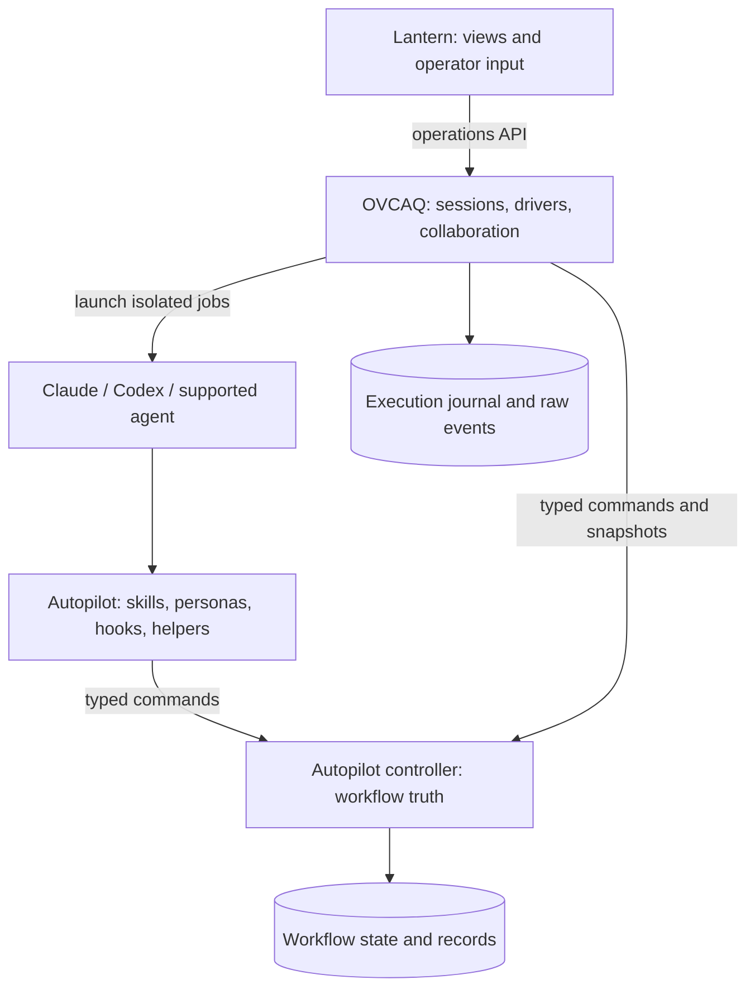

# Autopilot, OVCAQ and Lantern: three ownership layers

Status: target architecture requested 2026-10-25. Supersedes the earlier two-backend and OVCAQ-only-state designs. Implementation, publishing and personal cutover remain pending. Lantern is a provisional name, not a reserved package identity.

## Decision

Autopilot is an independently usable Agent Plugins package with one bundled workflow controller. OVCAQ supervises agent sessions above it. Lantern is a separate terminal client of OVCAQ. The plugin requires neither upper layer; OVCAQ does not require the TUI.

Workflow state and execution state are distinct authorities. They must not become competing copies of PRD status. The TUI has neither authority.

## Ownership

| Concern | Authoritative owner | Other layers |
| --- | --- | --- |
| Skills, personas, prompts, semantic staging/grouping, catchup | Autopilot plugin | OVCAQ launches declared roles; never vendors content |
| Workflow schema, PRD selection/entry/moves, tasks/attempts, transitions | Autopilot controller | Plugin and OVCAQ call the same controller |
| Code-owned lanes, required reviews, escalation, custody, verification | Autopilot controller | Plugin prepares evidence; OVCAQ supplies execution facts |
| Record-store commits and workflow recovery | Autopilot controller | OVCAQ requests commits at accepted boundaries |
| Process identity, launch/cancel/retry, driver/model placement, isolation | OVCAQ | Plugin supplies role requirements and resource references |
| Worktrees, wave scheduling, assembly/landing mechanics | OVCAQ | Controller owns semantic membership, acceptance and custody permission |
| Normalized observations, liveness, fleet discovery, execution journal | OVCAQ | Lantern renders the published projection |
| Views, keyboard controls, theme and preferences | Lantern | Calls OVCAQ; never accesses controller/registry files |
| Native interception/session identity | Client adapters | Enforce controller decisions where supported |

Dependencies: Lantern → OVCAQ → controller; agent/plugin → controller. OVCAQ understands an external workflow-provider protocol, not Autopilot implementation/persona names. No sibling-checkout imports. Autopilot imports neither upper layer; Lantern imports neither OVCAQ internals nor controller code.

Controller entry point: `python3 <installed-plugin-root>/controller/main.py`. It ships inside plugins/autopilot/controller. Python 3.12 is its execution baseline because extraction reuses OVCAQ's Python 3.12 services; the repository validator retains its Python 3.10 CI job. No daemon, broker, database service or mandatory MCP server.

## Reuse and preservation

Source plugin pin: e960ef1cc43e72bf92593b2f16c7a37c71ea7e48. Preserve eleven skills, eighteen personas and all 59 skill-relative references with section-level provenance. Initial portable version remains 0.10.0. Do not consolidate references. AP 00012's corrected contract freezes source assets, all principal/expanded behavior IDs, configuration fields and regression cases independently of the destination map. Each obligation names a delivery repository/PRD, interface/scenario and profile-specific evidence. Preserved assets are byte-identical; adapted sections have reasons. Ordinary CI uses committed provenance/fixtures; only an explicit maintainer source audit requires the pinned checkout.

OVCAQ at cf8be72214a515c84ee42f0d8b30e65cc2a4ebb7 has tested atomic state, locking, lifecycle intents/recovery, policy and records. Extract workflow portions and characterization fixtures into the controller with attribution. Preserve cf8be72's transition/pre-intent validation fixes; reconcile 00062 startup-revert changes before removing the old writer. Process state stays in OVCAQ. Legacy plugin code supplies missing behavior/equivalence fixtures, not another backend.

Transitional old OVCAQ code can remain until installed-controller equivalence passes, but each fresh canary chooses exactly one authority. OV 00058 removes direct workflow mutations and old writer entry points. No synchronization of writable workflow trees, live-state importer or permanent statectl/autoclaude/tracon aliases. Source retirement stays held.

## Contract A: controller and callers

Autopilot owns schemas, operations, golden fixtures and exports. AP 00018 establishes the protocol; 00019–00021 add capabilities. Consumers pin producer identity/version plus schema/fixture digests. Imported bundles are read-only; changes require regenerated consumer conformance.

CLI suffixes: `--json contract`, `--json snapshot --project-root PATH`, `--json apply --project-root PATH --request FILE`. OVCAQ uses [workflow].controller_argv (explicit argv array) and [workflow].contract_bundle (explicit path). No shell evaluation, executable auto-discovery, fetch or sibling inference. Controller resolves the project root; payloads cannot override state paths.

Contract: protocol_major=1, package_version, schema_digest, fixture_digest, operations, capabilities. IDs: workflow.core.v1, workflow.jobs.v1, workflow.reviews.v1, workflow.records.v1; optional workflow.waves.v1. Advertise only implemented operations.

Mutation envelope: protocol_major, operation, request_id, expected_revision, project_id, workflow_id, actor_id, job_id (nullable for operator actions), lease_epoch, payload. Only workflow.open on an absent store accepts null workflow_id/actor_id/lease_epoch with expected_revision zero. Bootstrap creates the operator credential under the controller's private state root (directory0700/file0600) and returns its path, never its secret. Other apply calls require --actor-file PATH; actor ID and scope must match that credential. OVCAQ's explicit [workflow].actor_file is the operator/orchestrator credential path; job credential paths are bound after driver environment construction. Response: ok, revision, result, error_code, retryable. Errors: invalid_request, incompatible_contract, revision_conflict, wrong_binding, missing_capability, rejected_evidence, recovery_required. API and durable schema versions differ.

Closed operations: workflow.open, policy.bind, owner.acquire/release/recover, prd.enter, task.replace/start/finish/attempt, lane.route, job.plan/claim/record_exit, review.record_stage/close, custody.record/discharge, verification.record, phase.handoff, prd.stall/park/defer/complete, artifact.record, records.commit. Optional wave operations record plans/member outcomes and authorize assembly/landing; they never spawn. Producer PRDs define payload schemas and negative fixtures before consumers depend on them. No arbitrary field setter.

Validate actor/job/epoch, revision, legal phase, artifacts and policy, then persist state/receipt atomically. Same request/payload replay returns the original result even after revision advances; changed payload ID reuse conflicts. Moves/git commits use recoverable intents. Rejection cannot partially advance workflow.

One controller-held execution lease prevents concurrent manual and supervised scheduling: one backend's fence, not another mode store. Controller issues restricted credentials bound to role, native session and epoch; caller-supplied identity strings are not proof. Orchestrators and jobs receive different scopes. Never log credentials. Recover ownership only after reconciling active jobs, never from timeout alone.

Code selects lanes/review requirements. Preserve full/fast-track rosters, Alice/Blake/Bob, blindness, R1–R5, default cap two, severe custody and solo escalation. Helpers classify/group findings; controller validates provenance/coverage/transitions. Completed reviewer results are separate from findings, so a real clean review has zero findings. Evidence binds to the controller's expected policy/profile, PRD/code/tree and allowed-input identities; submitted evidence cannot choose that context. Full/fast-track retain all mandatory and policy-activated roles; solo requires its real zero-context consensus pass. Required verdicts use source rubric namespaces, with the standing doubt R1–R5 semantics mapped to source D1–D5. Prose, exit zero, absent hooks or lower-level commands cannot waive requirements. Hooks still enforce pre-action restrictions such as push refusal. A CLI does not sandbox unrestricted filesystem access.

Verification binds code/tree identity, argv, exit/output and permitted record-only differences. Record commits include only eligible non-ignored configured records, exclude state/locks/logs/caches, preserve unrelated index/worktree changes and never force-add. Clean/ignored stores are no-ops. Reconcile crashes after commit without duplicates. Failure blocks advancement without rerunning the phase.

## Standalone execution

The same controller can open a workflow, select PRDs, record tasks/reviews and permit handoffs without OVCAQ. It emits structured next-job instructions: role, inputs/resources and binding. The user starts the next isolated client session and binds it through the plugin. Native delegation can satisfy explicitly permitted jobs; it cannot replace mandatory fresh coordinator review.

The plugin never relaunches coordinators, polls unattended queues or launches cross-driver CLI children as a hidden supervisor. Standalone is stateful but manually driven across sessions. Missing isolation/interception permits artifact skills but refuses affected workflow operations. Transfer to OVCAQ is possible after jobs exit and explicit lease transfer, without conversion or dual writes.

Agent Plugins portability covers skills and MCP. Client folders can package hooks, but do not guarantee universal execution. Each advertised execution host needs capability evidence and refusal behavior. [Specification](https://agent-plugins.org/specification), [client extensions](https://agent-plugins.org/plugin-authors/client-extensions).

## Contract B: OVCAQ execution

Controller job plans declare IDs, roles, dependencies, input/artifact references/digests, isolation, tier/effort hints and policy constraints. OVCAQ maps neutral roles/tiers to drivers/models, validates capabilities, claims jobs, launches processes and records normalized execution facts. Semantic acceptance/phase permission stays in the controller.

Mandatory scenario: Codex builds; fresh Claude reviews; blind reviewers receive PRD/rubric/allowed source, never builder narrative. Record actual driver/model/session/code identity. Required driver diversity without a compatible route refuses before launch. Retries use fresh contexts and bounded budgets. Managed use-codex/use-sonnet/use-gemini provide job intent/resources; OVCAQ launches cross-session jobs. Native subagents require the claimed job's explicit delegation capability.

Execution journal: run ID/epoch, process identity, launch intent, route, retries, normalized events and raw-output references. Cached workflow snapshots carry observed revisions, never become a second task/review machine. Persist intent, obtain claim, spawn, report outcomes idempotently. Test crashes around every boundary; reconcile exact identity/claim before reissue. Spawning is not exactly-once. Controller outage blocks scheduling/advancement; OVCAQ can still stop owned processes and reconcile later.

## Contract C: OVCAQ and Lantern

OV 00064 owns the operations schema/fixtures. Commands: `ovcaq --json operations contract`, `ovcaq --json operations list`, `ovcaq --json operations snapshot --run ID --epoch N`, `ovcaq operations events --run ID --epoch N --after SEQ` (JSONL), `ovcaq --json operations control --request FILE`.

Protocol-major 1 includes run_id, run_epoch, control_revision, observed_workflow_revision and observation sequence. Snapshots expose fleet/PRD/task/review/job/wave/capability/attention/usage projections and freshness. Events have bounded retention and explicit gap/reset markers; clients resnapshot on gaps. Unavailable controller, unknown liveness and partial/raw-only telemetry are explicit, never completed. OVCAQ owns discovery, liveness and safe log access; UI never scans registry/raw provider files.

Controls: pause, resume, stop, retry. Requests: request_id, run_id, run_epoch, expected_control_revision, observed_workflow_revision, payload. Responses distinguish accepted, applied, rejected and committed-but-observation-stale. OVCAQ revalidates identity/controller preconditions; stale selection cannot control replacement runs. Stop remains available during controller outage with pending reconciliation explicit. Exact run epoch/control revision remain mandatory for stop; stale or unavailable workflow revision cannot veto stopping owned processes. Pause stops new dispatch at a safe boundary; resume rechecks controller permission; retry requests a legal new job attempt, never rewinds workflow state. These scheduling controls live in the execution journal. Cancellation/escalation belongs to OVCAQ.

Lantern owns Textual/Rich, rendering, keyboard interaction, preferences and its own XDG theme path. It invokes configured OVCAQ argv and uses only the API. Detach, close, crash, incompatible UI or terminal failure cannot stop a run. Preserve existing sanitization, literal markup, bounded tails, responsiveness and stale-selection feedback. No separate liveness algorithm.

After extraction `ovcaq run` is headless in TTY/non-TTY, foreground by default; `--detach` explicitly backgrounds supervision and returns run identity. `lantern attach --run ID --epoch N` attaches separately. Remove implicit TUI launch, OVCAQ attach and --no-tui with generated help/docs and migration diagnostics, not permanent aliases. OVCAQ must run with Textual, Rich and Lantern absent.

## Delivery graph and parallel worktrees

| Workstream | PRDs and order | Interface gate |
| --- | --- | --- |
| Plugin content/hosts | AP 00012 → 00013 → 00014 → 00015 | Policy/evidence frozen in 00012 |
| Controller | AP 00012 → 00018 → 00019 → 00020 → 00021 | 00018 exports protocol; capabilities gated |
| Standalone | AP 00016 after 00015 + 00020 + 00021; then 00017 | No OVCAQ prerequisite |
| OVCAQ client | OV 00057 after AP 00018 bundle; 00058 after 00057 + 00062 + AP 00021 artifact | Remove old authority after equivalence |
| Collaboration | OV 00059 after 00058 + 00063; then 00060; then 00061 with AP 00017 artifact | Isolation, recovery, then waves |
| Operations API | OV 00064 after 00058, parallel with 00059/00060 | Separate projection/API; shared CLI edits serialized |
| TUI | Lantern 00001 → 00002 after OV 00064; 00003 after 00002 + OV 00060/00061 | Fixtures first, installed integration last |
| Remove bundled UI | OV 00065 after 00060/00061/00064 + Lantern 00003 artifact | Headless and detached UI acceptance |

OV 00062/00063 remain unchanged robustness work. Avoid simultaneous cli.py/config.py/prerequisite-helper edits; use fixture adapters until producer merge. AP 00012 creates the prerequisite table above, including later controller dependencies. Every unit has a reviewable result. The 2026-10-25 AP 00012 contract amendment supersedes the prior foundation design approval; any work already started must reconcile the amendment before acceptance. Schema changes originate in the producer and regenerate consumer fixtures.

Read-only eligibility uses local done-bucket evidence and explicit cross-repository artifacts, never adjacency. AP 00016/00017 never probe OVCAQ. OV 00057 can use an AP 00018 bundle and fake executable; 00058 needs actual core/jobs/reviews/records. All process/workflow/git canaries use temporary roots, never the implementation batch's state.

## Completion and cutover

Preserve P01–P11/R01–R31 and expanded inventory rows. R11/R12/R16 workflow acceptance → controller; R13/R15 processes → OVCAQ; R14 → Lantern plus operations API; R28 splits state locks/processes; record commits → controller. No silent drops. Source/behavior/regression maps are checked against the independent expected inventory; an unavailable feature remains incomplete for any profile that promises it. Source retirement requires concrete passing evidence, not just assigned owners or preserved headings.

AP 00017 proves installed standalone use with upper layers absent. OV 00060 proves mixed-driver execution through that controller. OV 00065 proves headless packaging. Lantern 00003 proves installed views/controls/detach. Real host probes remain distinct from fake-driver tests; missing auth/binaries means unavailable.

Held OV 00010 provisions external Autopilot/catalogs and pins controller compatibility; bundles neither plugin nor TUI. Held 00011 requires standalone, same-controller managed, mixed-driver, wave and separate-TUI canaries plus every source disposition. Held 00014 covers independent distributions. Agoge and original task IDs stay intact. No hold, installation, publication or deletion is authorized here.

## Unresolved questions

No blocking architecture question. Lantern remains provisional pending the optional naming preference; branding does not change contracts. Unsupported hosts have explicit refusal outcomes.
